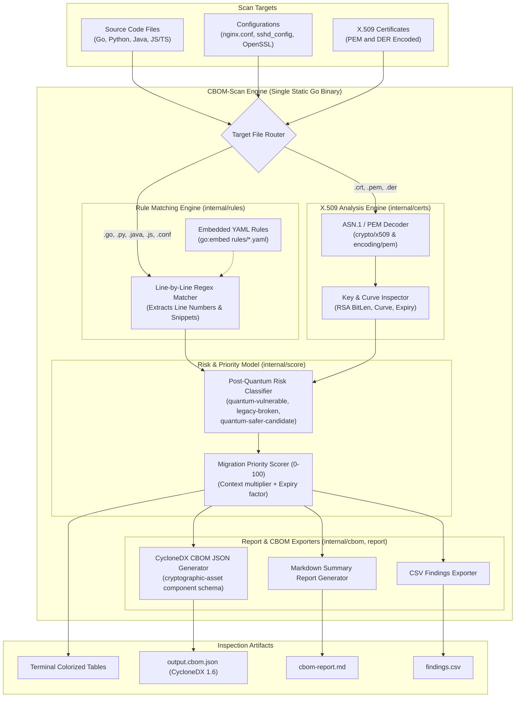

# Architecture: CBOM-Scan

`cbomscan` discovers and inventories cryptographic assets across source code repositories, configurations, and X.509 certificates, computes post-quantum migration risk scores, and outputs a standard CycloneDX Cryptographic Bill of Materials (CBOM).

## System Architecture Diagram

## Core Modules

1. **Rule Engine (`internal/rules`):**
   Loads embedded language and config rules. Uses compiled Go regular expressions to inspect files line-by-line, capturing line numbers, source snippets, and matched cryptographic tokens.

2. **Certificate Parser (`internal/certs`):**
   Decodes PEM blocks and raw DER byte sequences using standard library `crypto/x509`. Extracts asymmetric public key algorithms, RSA bit lengths, elliptic curves, validity dates, days until expiry, and signature digests.

3. **Risk Classifier:**
   Enforces NIST post-quantum guidance:
   - `quantum-vulnerable`: Asymmetric algorithms broken by Shor's algorithm (RSA, ECC, ECDH, ECDSA).
   - `legacy-broken`: Obsolete or cryptanalytically broken algorithms (MD5, SHA-1, DES, 3DES, RC4).
   - `quantum-safer-candidate`: Symmetric ciphers $\ge$ 128-bit security and approved PQC candidates (AES-256, SHA-256, ML-KEM, ML-DSA).

4. **Migration Scorer (`docs/scoring.md`):**
   Calculates a standardized $0-100$ priority score factoring in algorithmic vulnerability, sensitive path indicators (`auth`, `payment`), and certificate expiry urgency.
